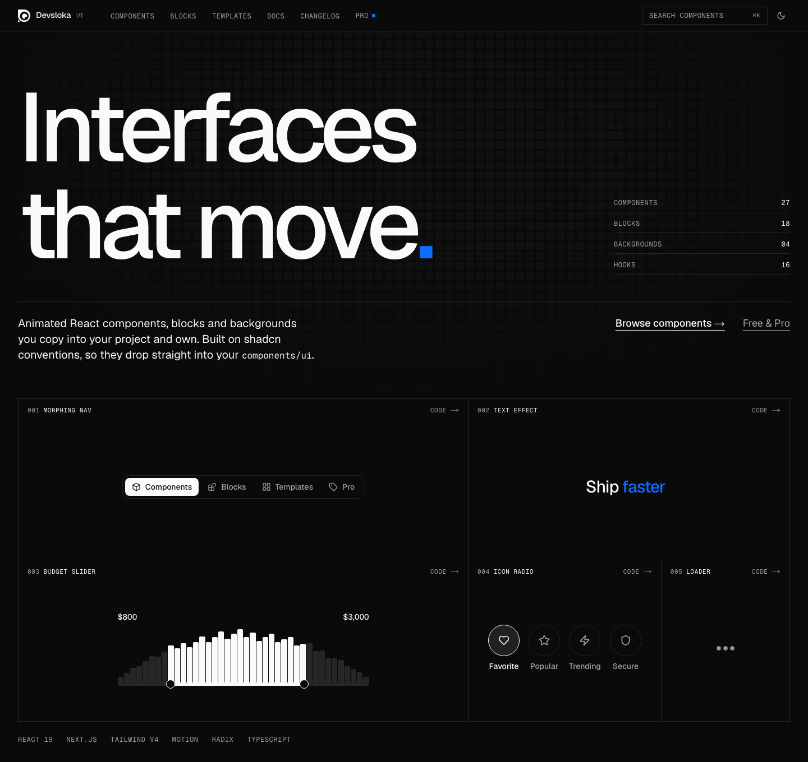

# Devsloka UI

[](LICENSE)

Animated React components, blocks, backgrounds, hooks, and templates you copy into your project and own. Built with TypeScript, Tailwind CSS v4, Motion, and Radix UI, following shadcn conventions.

[Explore the library](https://ui.devsloka.in) · [Documentation](https://ui.devsloka.in/docs) · [Installation](https://ui.devsloka.in/installation) · [Changelog](https://ui.devsloka.in/changelog)



## What’s inside

- **Animated components:** Navigation, cards, carousels, inputs, text effects, and feedback states.
- **Page blocks:** Marketing sections, authentication screens, and 404 layouts with multiple variants.
- **Backgrounds and hooks:** Visual backgrounds and reusable hooks for common React interactions.
- **Templates:** AI agent landing page, developer portfolio, and e-commerce starter sites.
- **Live previews:** Browse the homepage index by category and try text animations in the [playground](https://ui.devsloka.in/#playground).
- **Theming:** Light and dark modes, CSS variables, and Devsloka blue (`#0A6EFF`) across the latest blocks.
- **Source ownership:** Install through the shadcn CLI or copy the files manually, then customize them in your own repository.

The current catalog contains 27 components, 4 backgrounds, 16 hooks, and 18 block categories with 42 block variants. Components, backgrounds, hooks, and blocks are distributed as 89 registry items; the 3 templates have separate source repositories linked from their detail pages.

## Installation

Start with a React 19 and Tailwind CSS v4 project configured for shadcn components. See the [installation guide](https://ui.devsloka.in/installation) for setup and manual installation instructions.

Install a component by its registry name:

```bash
npx shadcn@latest add https://ui.devsloka.in/r/text-effect.json
```

Or use Bun:

```bash
bunx shadcn@latest add https://ui.devsloka.in/r/text-effect.json
```

Blocks install the same way. Use the variant’s registry name rather than its documentation category:

```bash
npx shadcn@latest add https://ui.devsloka.in/r/sign-in-split.json
```

Browse [registry.json](registry.json) for available names. For manual installation, copy the source and install the dependencies shown on the component’s documentation page.

## Usage

After installing Text Effect:

```tsx
"use client";

import { TextEffect } from "@/components/ui/text-effect";

export default function Example() {
  return (
    <h1>
      Ship <TextEffect words={["faster", "calmer", "better"]} effect="slide" />
    </h1>
  );
}
```

Components support props for their content and behavior. The latest blocks also expose colour props so you can adapt the default Devsloka blue to your brand. Check each component’s source and live demo for its API.

## Components and blocks

Explore the [component library](https://ui.devsloka.in/components) for morphing navigation, cards and modals, animated galleries, carousels, radio inputs, range sliders, text effects, loaders, and more.

The Laptop Closes on Scroll component uses a scroll-driven lid animation that closes flush with the base, hides the screen when fully closed, and stays open when reduced motion is enabled.

The [block library](https://ui.devsloka.in/blocks) includes:

| Category | Layouts |
| --- | --- |
| Hero | Multiple variants, including floating elements, gradient mesh, and split reveal |
| Features | Section layouts, interactive cards, and floating showcase |
| Pricing | Pricing section |
| Testimonials | Two variants |
| FAQ | Two variants |
| Team | Team section |
| Contact | Contact section |
| Newsletter | Two variants |
| Logo Cloud | Logo section |
| Footer | Standard, floating, grid, and wave layouts |
| Changelog | Timeline, release, and compact layouts |
| Blog | Featured, index, and magazine layouts |
| Call to Action | Poster, split photo, and ticket layouts |
| Sign In | Split and minimal layouts |
| Sign Up | Split and step-based layouts |
| Forgot Password | Request and reset layouts |
| OTP | Email code and two-factor verification layouts |
| 404 | Poster and lost-and-found layouts |

Authentication blocks provide form interactions and submission callbacks. Connect those callbacks to your own authentication service.

Find the source in [src/registry/ui](src/registry/ui), [src/registry/blocks](src/registry/blocks), [src/registry/backgrounds](src/registry/backgrounds), and [src/registry/hooks](src/registry/hooks). Browse full-page [templates](https://ui.devsloka.in/templates) for live previews and links to their repositories.

## Release history

- **May 21, 2025:** The first version of Devsloka UI launched. [Original announcement](https://x.com/devsloka/status/1925188390149923023).
- **October 11, 2026:** Refreshed homepage, expanded block library, consistent blue styling, and a dedicated changelog page.

Read the [changelog](https://ui.devsloka.in/changelog) for release details. To add a release, update [src/lib/changelog.ts](src/lib/changelog.ts) with a fixed date and place the newest entry first.

## Local development

With Node.js and npm installed:

```bash
git clone https://github.com/devsloka/ui-devsloka.git
cd ui-devsloka
npm ci
npm run dev
```

Open [localhost:3000](http://localhost:3000). The documentation site runs on Next.js.

To build and serve the production site:

```bash
npm run build
npm run start
```

## Contributing

Keep changes consistent with the existing component APIs, blue styling, and light/dark themes. Check keyboard interactions and reduced motion where applicable.

When changing registry components or adding new items, update [registry.json](registry.json) as needed, regenerate the installable files, and verify them:

```bash
npm run registry:build
npm run registry:check
npm run build
```

The registry builder derives npm and registry dependencies from source imports and writes the installable JSON files to [public/r](public/r). Use `npm run lint` to check code style.

For changes to a component’s appearance, regenerate its preview image against a running local site. In a second terminal:

```bash
# Capture one component
npm run previews -- laptop-closes-on-scroll

# Capture all published previews
npm run previews
```

The capture script uses a local Chromium-based browser. Set `CHROME_PATH` if it cannot locate yours, and `BASE_URL` if the site runs somewhere other than `http://localhost:3000`.

## SEO and AI discovery

The site publishes a [sitemap](https://ui.devsloka.in/sitemap.xml), [robots.txt](https://ui.devsloka.in/robots.txt), an [AI documentation index](https://ui.devsloka.in/llms.txt), and a [full context guide](https://ui.devsloka.in/llms-full.txt). `/llm.txt` also serves the AI index.

The sitemap and context guides use the published catalogs and registry, including every component, background, hook, block variant, template, and release entry. New catalog entries appear when the site is rebuilt. Shared titles, descriptions, canonical URLs, and social metadata are configured in [src/config/seo](src/config/seo).

After building and starting the production site, verify every public page and discovery endpoint:

```bash
npm run seo:check

# For a server running on another port
BASE_URL=http://localhost:3124 npm run seo:check
```

## License

Released under the [MIT License](LICENSE), for personal and commercial projects.

Built by [Devsloka](https://www.devsloka.in/). Report bugs and request features through [GitHub Issues](https://github.com/devsloka/ui-devsloka/issues).
